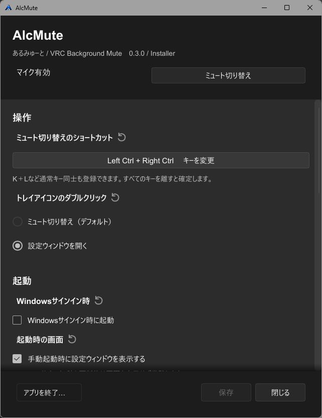

# AlcMute User Guide

AlcMute is a Windows 10 / 11 app that lets you toggle your VRChat microphone using a shortcut or the system tray, even while another app is active.

## Installation and updates

[Download the latest release](https://github.com/alcnaka/AlcMute/releases/latest). For most users, the Installer edition (Setup.exe) is recommended.

| | Installer | Portable |
| --- | --- | --- |
| Getting started | Run Setup.exe | Extract the ZIP and run alcmute.exe |
| Start at Windows sign-in | Supported | Not supported |
| Updating | Update from the app | Replace the EXE using a new ZIP |

If AlcMute is already running, choose Exit from its tray menu before installing. Your existing settings are kept.

After installation, the Installer edition runs in the system tray. Open Settings from the Start menu or the tray menu.

To uninstall, use Windows Settings > Apps. Your saved settings are kept.

## Basic operation

### Getting started

1. Enable **OSC** and **Toggle Voice** in VRChat.
2. Start AlcMute.
3. Press **Ctrl + Alt + M** to toggle mute.

The tray icon is **green when the microphone is active, red when muted, and gray with a question mark when the state is unknown**.

Right-click the tray icon to toggle mute, open Settings, or exit. If the icon is hidden, check the tray overflow menu on the right side of the taskbar.

Closing Settings with Close or the X button leaves AlcMute running in the tray. To stop it, choose Exit from the tray menu or Quit app in Settings.

### Changing the shortcut

1. In Settings, click Change keys.
2. Press your key combination, then release all keys.
3. Click Save. Press Esc to cancel recording.

To distinguish left and right Ctrl, Alt, and other modifier keys, enable Distinguish left and right modifiers before recording. Changing this checkbox does not alter your existing shortcut. Modifier-only combinations and combinations such as K + L are also supported.

Shortcuts work while Settings is open. They pause only during key recording. If another app responds to the same keys, choose a different combination.

You can also record the two standard mouse side buttons as Mouse4 or Mouse5, alone or combined with keys such as Ctrl. Their normal actions in other apps, such as Back and Forward, are not blocked. If your mouse software remaps a button to a keyboard key, AlcMute may recognize that key instead.



## Changing settings

Click Save after changing settings. Save is enabled only when there are unsaved changes.

- **Tray double-click**: Toggle mute or open Settings.
- **Start at Windows sign-in**: Available in the Installer edition.
- **Show Settings when launched manually**: Turn this off to start in the tray.
- **Theme**: Choose System, Light, or Dark. System follows your Windows setting.
- **Language**: Choose System, Japanese, or English, then save. System uses Japanese on Japanese Windows and English on other Windows display languages.

The circular arrow beside a setting restores its default value. Reset all settings asks for confirmation before deleting saved settings. It also disables sign-in startup for the Installer edition.

You normally do not need to change the OSC addresses. The defaults are 127.0.0.1:9000 for sending and 127.0.0.1:9001 for receiving.

## Updates

Click Check for updates in Settings or the tray menu. Follow the on-screen instructions if a newer version is available.

To disable checks at startup, clear Check for updates on startup and click Save.

For the Portable edition, download the new ZIP, exit AlcMute, then replace the EXE.

## Troubleshooting

### Mute does not toggle

Check that OSC and Toggle Voice are enabled in VRChat. If only the shortcut fails, try toggling mute from the tray menu, then change the shortcut and save.

A gray question mark means AlcMute cannot read the mute state. It does not mean you are muted. Check the microphone state in VRChat too.

### An update fails

Exit AlcMute and run the [latest Setup.exe](https://github.com/alcnaka/AlcMute/releases/latest) manually. Your settings are kept. This also works around os error 31 when updating from v0.3.0 or v0.3.1.

### AlcMute will not start or save settings

Check the error message. If AlcMute offers to restore a damaged settings file, you can recover it from the backup.

When asking for help, include your AlcMute version, what you did, and the error message. If a log is needed, error.log is in this folder:

```text
%LOCALAPPDATA%\Alcnaka\AlcMute
```

This folder also contains your settings. You do not need to delete your settings file to ask for help.
