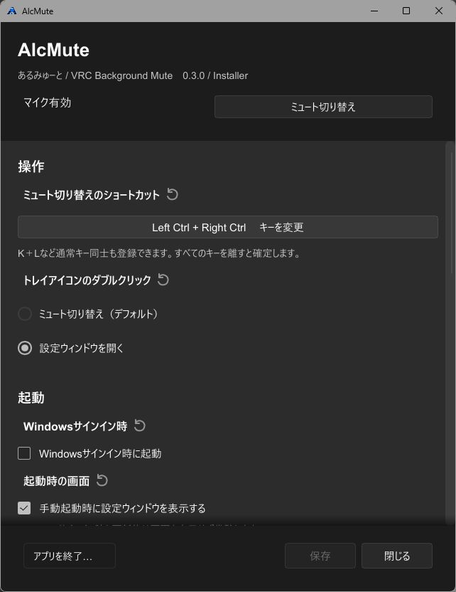

# AlcMute 利用ガイド

AlcMute（あるみゅーと）は、VRChatのマイクミュートをショートカットや通知領域から切り替えるWindows 10 / 11向けアプリです。

## インストールと更新

[最新版のダウンロード](https://github.com/alcnaka/AlcMute/releases/latest)から、通常はInstaller版（Setup.exe）を選んでください。

| | Installer版 | Portable版 |
| --- | --- | --- |
| 導入 | Setup.exeを実行 | ZIPを展開してalcmute.exeを実行 |
| Windowsサインイン時の自動起動 | 設定可能 | 非対応 |
| 更新 | アプリ内から更新 | 新しいZIPで手動差し替え |

すでにAlcMuteを使っている場合は、トレイメニューの「終了」で終了してからインストールしてください。既存の設定は引き継がれます。

Installer版は、インストール後にトレイへ常駐します。設定画面はスタートメニューの「AlcMute」、またはトレイメニューの「設定」から開けます。

アンインストールはWindowsの「設定」→「アプリ」から行えます。保存した設定は残ります。

## 基本操作

### 使い始める

1. VRChatで**OSC**と**Toggle Voice**を有効にします。
2. AlcMuteを起動します。
3. **Ctrl + Alt + M**でミュートを切り替えます。

トレイアイコンは、**緑がマイク有効、赤がミュート、灰色の「？」が状態不明**です。

トレイアイコンの右クリックからも、ミュート切り替え・設定・終了を選べます。アイコンが見つからないときは、タスクバー右側の「隠れているインジケーターを表示」を確認してください。

設定画面の「閉じる」や×では常駐を終了しません。終了するときはトレイメニューの「終了」、または設定画面の「アプリを終了…」を選びます。

### ショートカットを変更する

1. 設定画面の「キーを変更」を押します。
2. 登録したい組み合わせを押し、すべてのキーを離します。
3. 「保存」を押します。記録をやめる場合はEscを押します。

Ctrl・Altなどの左右を指定したい場合は、記録前に「修飾キーの左右を区別する」をONにします。チェックの変更だけでは、登録済みのキーは変わりません。修飾キーだけの組み合わせや、K + Lなども登録できます。

設定画面を開いていてもショートカットは使えます。キーを記録している間だけ停止します。同じキーで他のアプリも反応する場合は、別の組み合わせに変更してください。



## 設定を変更する

設定を変更したら「保存」を押してください。変更がある場合だけ「保存」が有効になります。

- **トレイのダブルクリック**：ミュート切り替え、または設定画面を開く動作を選べます。
- **Windowsサインイン時に起動**：Installer版で利用できます。
- **手動起動時に設定ウィンドウを表示**：OFFにすると、起動時からトレイへ常駐します。
- **テーマ**：自動・ライト・ダークから選べます。自動はWindowsの設定に合わせます。
- **言語**：自動・日本語・Englishから選び、「保存」で切り替えます。自動はWindowsの表示言語が日本語なら日本語、それ以外は英語になります。

項目名の横の回転矢印で、その項目を初期値に戻せます。「すべての設定を初期化」では、確認後に保存した設定を削除します。Installer版の自動起動も解除されます。

OSCの送受信先は、通常は変更不要です。初期値は送信先127.0.0.1:9000、受信先127.0.0.1:9001です。

## アップデート

設定画面またはトレイメニューの「アップデートを確認」から確認できます。新しいバージョンがある場合は画面の案内に従ってください。

起動時の確認を止めたい場合は、「起動時にアップデートを確認」をOFFにして「保存」を押します。

Portable版は、新しいZIPをダウンロードし、AlcMuteを終了してからEXEを差し替えてください。

## 困ったとき

### ミュートを切り替えられない

VRChatのOSCとToggle Voiceが有効か確認してください。ショートカットだけが動かないときは、トレイメニューからの切り替えを試し、キーを変更して保存してください。

灰色の「？」はミュート状態を取得できていないことを表します。ミュート済みとは限らないため、VRChat側でも確認してください。

### 更新に失敗する

AlcMuteを終了し、[最新版のSetup.exe](https://github.com/alcnaka/AlcMute/releases/latest)を手動で実行してください。既存の設定は維持されます。v0.3.0／v0.3.1でos error 31が出る場合も、この方法で更新できます。

### 起動できない・設定を保存できない

表示されたエラーメッセージを確認してください。設定ファイルの破損時に復元確認が表示された場合は、バックアップから復元できます。

問い合わせ時には、AlcMuteのバージョン・行った操作・エラーメッセージを添えてください。ログが必要な場合は、次のフォルダーのerror.logを確認できます。

```text
%LOCALAPPDATA%\Alcnaka\AlcMute
```

このフォルダーには設定も保存されています。問い合わせのために設定ファイルを削除する必要はありません。
